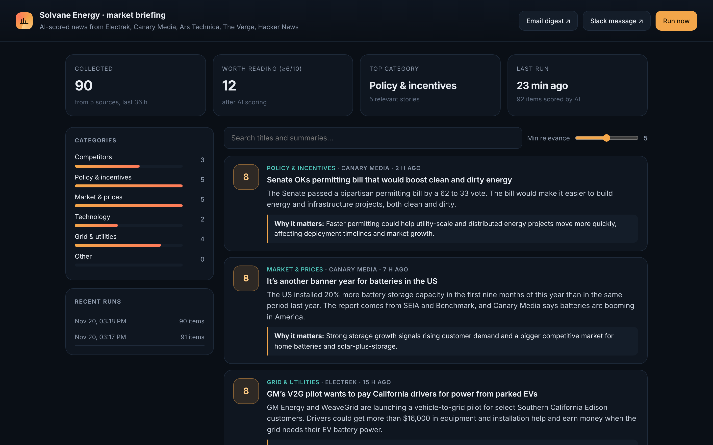
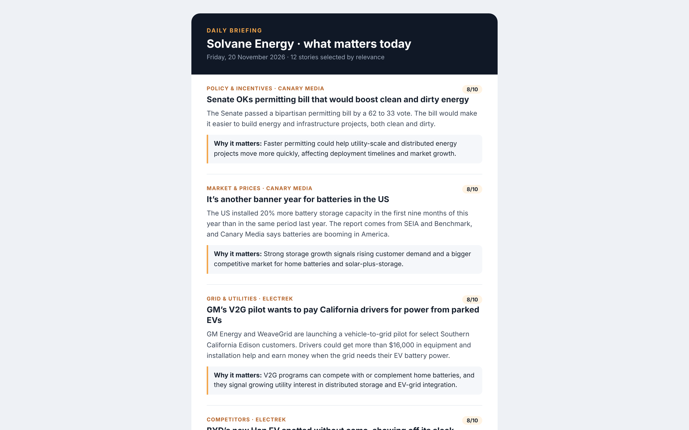

# AI Market Briefing: daily news intelligence on autopilot


Every morning this pipeline collects the latest stories from industry news feeds and Hacker News. AI scores each story for relevance to *your* company, sorts it into a category, writes a two-sentence summary and adds a one-line "why it matters". The best stories go out as an email digest and a Slack message, and everything is kept in a searchable dashboard.





## Pipeline
1. **Collect:** RSS or Atom feeds plus the Hacker News API (add any feed in `config.json`).
2. **Clean:** de-duplicate by title and keep only the last 36 hours.
3. **Enrich:** an OpenAI model returns strict JSON (structured outputs) with relevance 0-10, category, summary and implication, all against the company profile in `config.json`.
4. **Store:** SQLite, with run history.
5. **Deliver:** an HTML email (SMTP), Slack Block Kit (incoming webhook), and a dashboard with filters and search.

## Run it
```bash
pip install -r requirements.txt
export OPENAI_API_KEY=sk-...
python -m briefing.pipeline                      # one run
uvicorn briefing.server:app --port 8020          # dashboard
```
Optional delivery settings: `SLACK_WEBHOOK_URL`, `SMTP_HOST`, `SMTP_PORT`, `SMTP_USER`, `SMTP_PASSWORD`, `DIGEST_TO`.

## Schedule
- cron: `0 6 * * 1-5 cd /srv/briefing && python -m briefing.pipeline`
- or GitHub Actions: copy `deploy/github-actions.yml` to `.github/workflows/` (runs on weekdays at 06:00 UTC)

Change the company profile, categories and sources in `config.json`. Nothing else needs to change.
